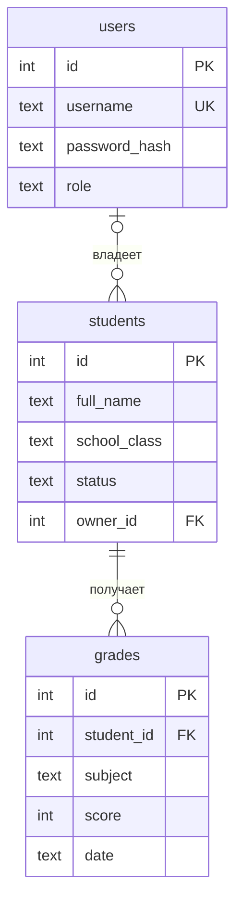

# Электронный дневник

Тема №21: **Электронный дневник** — сервис для учителя, в котором можно вести список учеников и ставить им оценки.

| | |
| --- | --- |
| Главная сущность | Ученик |
| Связанная сущность (1:N) | Оценка: у одного ученика может быть несколько оценок |
| Фишка | Одна оценка по предмету за день и средний балл по предметам |
| Стек | Python, FastAPI, SQLite, Alembic, Argon2, PyJWT |

## Как запустить

Команды для PowerShell из папки проекта `D:\back`.

```powershell
.\.venv\Scripts\python -m pip install -r requirements.txt
$env:DATABASE_PATH = "diary.db"
.\.venv\Scripts\python -m uvicorn app.main:app --port 8000
```

При запуске Alembic применяет миграции. Пример настройки пути к базе — в [файле окружения](.env.example). Данные сохраняются после перезапуска, если использовать тот же файл базы.

Чтобы отдельно применить миграции и заполнить пустую базу тестовыми данными:

```powershell
.\.venv\Scripts\python -m alembic upgrade head
.\.venv\Scripts\python -m app.seed
```

Миграция `001` создаёт таблицы из [схемы SQLite](app/schema.sql), `002` добавляет индексы, а `003` добавляет пользователей и владельца записи. Старые и демонстрационные записи без владельца может менять только администратор. Если в старой базе уже есть дубли оценок, миграция индексов остановится и не удалит данные.

Сервис работает на [localhost:8000](http://localhost:8000). Swagger — на [localhost:8000/docs](http://localhost:8000/docs). Запросы для демонстрации — в [requests.http](requests.http).

Если окружения ещё нет, сначала выполни `python -m venv .venv`.

Для JWT и администратора задай настройки **до запуска сервера**, в том же PowerShell:

```powershell
$env:JWT_SECRET = python -c "import secrets; print(secrets.token_hex(32))"
$env:JWT_TTL_SECONDS = "3600"
$env:ADMIN_USERNAME = "admin"
$env:ADMIN_PASSWORD = Read-Host "Пароль нового администратора (от 8 символов)" -MaskInput
```

Без JWT-секрета Basic Auth работает, а выдача токена отключена. Администратор создаётся при первом запуске с этими настройками; повторный запуск не меняет его пароль. Basic Auth на локальном стенде удобен для проверки; вне локального стенда нужен HTTPS.

## Эндпоинты

| Метод | Путь | Что делает | Ответ |
| --- | --- | --- | --- |
| GET | `/health` | Проверить сервер | 200 `{"status":"ok"}` |
| POST | `/auth/register` | Создать пользователя | 201; 400; 409 |
| POST | `/auth/login` | Получить JWT | 200; 400; 401; 429; 503 без настройки JWT |
| GET | `/auth/me` | Получить профиль без пароля | 200; 401 |
| POST | `/api/students` | Добавить ученика | 201 и ученик с `id`; 400 |
| GET | `/api/students` | Получить список, искать по ФИО через `q` | 200; 400 |
| GET | `/api/students/stats` | Получить средний балл и количество оценок по предметам | 200 |
| GET | `/api/students/{id}` | Получить ученика | 200; 400; 404 |
| PATCH | `/api/students/{id}` | Изменить данные ученика | 200; 400; 404 |
| DELETE | `/api/students/{id}` | Удалить ученика и его оценки | 204; 400; 404 |
| POST | `/api/students/{id}/grades` | Поставить оценку от 2 до 5 | 201 и оценка с `id`; 400; 404; 409 при дубле |
| GET | `/api/students/{id}/grades` | Получить оценки ученика | 200; 400; 404 |

Поиск `/api/students?q=иванов` находит и «Иванов», и «ИВАНОВ». SQLite ищет совпадение после приведения ФИО и запроса к одному регистру. Повторную оценку по тому же предмету в тот же день для того же ученика блокирует уникальный индекс при вставке.

Чтение дневника открыто. Для записи войди через **Authorize** в Swagger или передай заголовок Basic/Bearer. Без входа ответ будет `401`, при попытке изменить чужую запись — `403`. Сервер сам ставит `owner_id` из профиля. Оценки может добавлять владелец ученика или администратор. После пяти неудач за минуту для пары IP и логина следующая попытка даёт `429`; счётчик хранится в памяти процесса.

Для проверки используй `backcheck --lab 3 --stars` на отдельной базе. Администратор из `contract.json` — только тестовый: для проверки роли настрой `ADMIN_USERNAME=admin` и `ADMIN_PASSWORD=admin-test-pass` при запуске **новой тестовой базы**.

### Индекс для списка по классу

```sql
EXPLAIN QUERY PLAN
SELECT * FROM students WHERE school_class = '8А' ORDER BY id LIMIT 10 OFFSET 0;
```

Вывод SQLite:

```text
SEARCH students USING INDEX ix_students_class (school_class=?)
```

## ER-диаграмма



`grades.student_id` ссылается на `students.id`. У ученика может быть от нуля до нескольких оценок.

- **SQLite** хранит учеников и оценки в файле. Данные остаются после перезапуска, и не нужно запускать отдельный сервер базы.
- **`DATABASE_PATH`** позволяет указать другой файл базы без изменения кода. Например, можно завести отдельную базу для демонстрации.
- **Внешний ключ `student_id`** привязывает каждую оценку к существующему ученику. `ON DELETE CASCADE` удаляет его оценки вместе с ним, чтобы они не остались без ученика.
- **Параметры `?` в SQL** отделяют значения от команд. Если в ФИО написать кусок SQL, база сохранит его как текст.
- **Alembic** хранит историю изменений базы: сначала создаются таблицы, потом добавляются индексы. Команда `app.seed` заполняет пустую базу примерами для проверки.
- **Индекс по классу** помогает SQLite находить учеников нужного класса, не перебирая всю таблицу. В выводе `EXPLAIN QUERY PLAN` видно, что база использует индекс.
- **`casefold` и `instr`** нужны для поиска по части ФИО без учёта регистра, в том числе для русских букв. SQLite отбирает совпадения до пагинации.
- **Уникальный индекс** не даёт записать вторую оценку тому же ученику за ту же дату с тем же названием предмета. Проверка происходит при вставке, а при конфликте API отвечает `409`.
- **`GROUP BY`, `AVG` и `COUNT`** группируют оценки по предметам и считают средний балл и число оценок прямо в базе, без цикла в Python.
